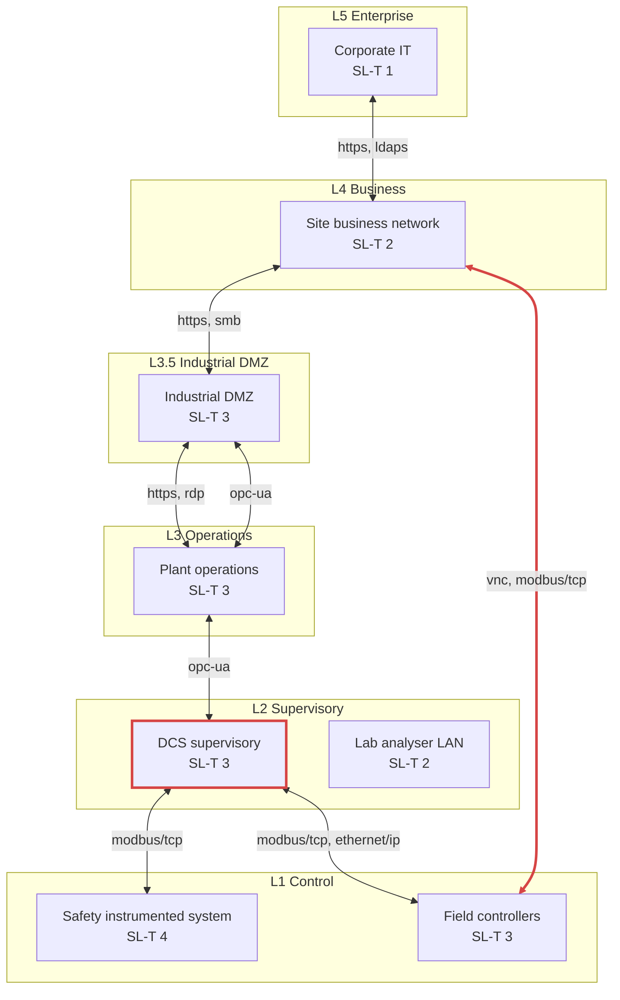

# Zone and conduit review: Example gas processing plant

8 zones, 8 conduits. Findings: 5 high, 7 medium, 4 low.

## Zones

| Zone | Level | SL-T | SL-A (FR1-FR7) |
|---|---|---|---|
| Corporate IT | 5 | 1 | 2 2 2 2 2 2 2 |
| Site business network | 4 | 2 | 2 2 1 2 2 2 2 |
| Industrial DMZ | 3.5 | 3 | 3 3 2 3 3 2 3 |
| Plant operations | 3 | 3 | 2 2 2 2 3 2 2 |
| DCS supervisory | 2 | 3 | 2 2 3 1 3 2 3 |
| Lab analyser LAN | 2 | 2 | not assessed |
| Safety instrumented system | 1 | 4 | not assessed |
| Field controllers | 1 | 3 | 2 2 2 2 2 2 2 |

## Findings

| Severity | Rule | Where | Detail |
|---|---|---|---|
| high | cleartext-ot | c08 | modbus/tcp carried up to L4; terminate it at L3 and replicate data instead |
| high | level-skip | c08 | Site business network (L4) reaches Field controllers (L1) without passing a DMZ |
| high | remote-access-jump | c08 | remote access lands in a control zone without a jump host |
| high | remote-access-mfa | c08 | remote access path without MFA |
| high | sl-gap | dcs | DCS supervisory target SL3, below target on FR1=2, FR2=2, FR4=1, FR6=2 |
| medium | cleartext-it | c08 | cleartext management protocol(s): vnc |
| medium | diode-direction | c07 | conduit is marked as a diode but direction is 'both' |
| medium | missing-boundary | c08 | SL-T changes 2->3 across this conduit but no firewall or diode is listed |
| medium | sl-gap | biz | Site business network target SL2, below target on FR3=1 |
| medium | sl-gap | dmz | Industrial DMZ target SL3, below target on FR3=2, FR6=2 |
| medium | sl-gap | field | Field controllers target SL3, below target on FR1=2, FR2=2, FR3=2, FR4=2, FR5=2, FR6=2, FR7=2 |
| medium | sl-gap | ops | Plant operations target SL3, below target on FR1=2, FR2=2, FR3=2, FR4=2, FR6=2, FR7=2 |
| low | orphan-zone | lab | Lab analyser LAN has no conduits; either it is isolated or a path is undocumented |
| low | remote-access-recording | c08 | remote sessions are not recorded |
| low | sl-unassessed | lab | Lab analyser LAN has no SL-A recorded |
| low | sl-unassessed | sis | Safety instrumented system has no SL-A recorded |

## Diagram

